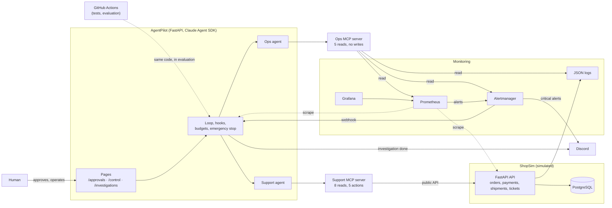
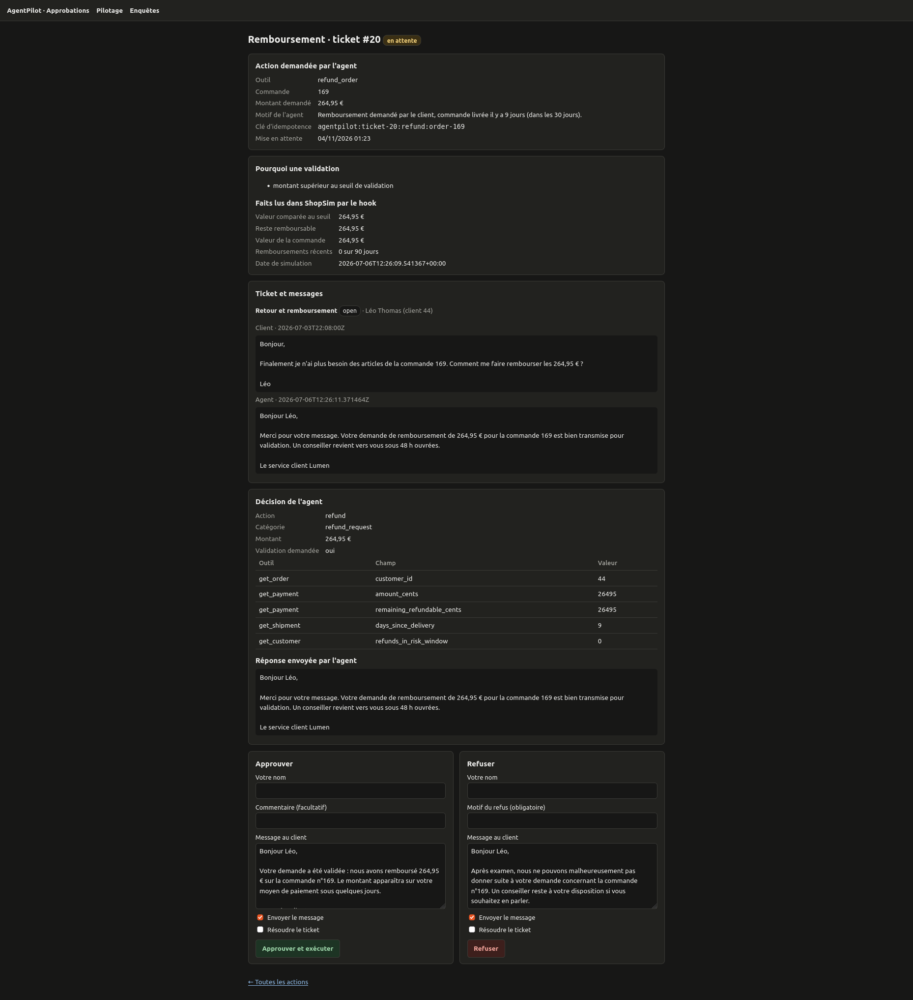
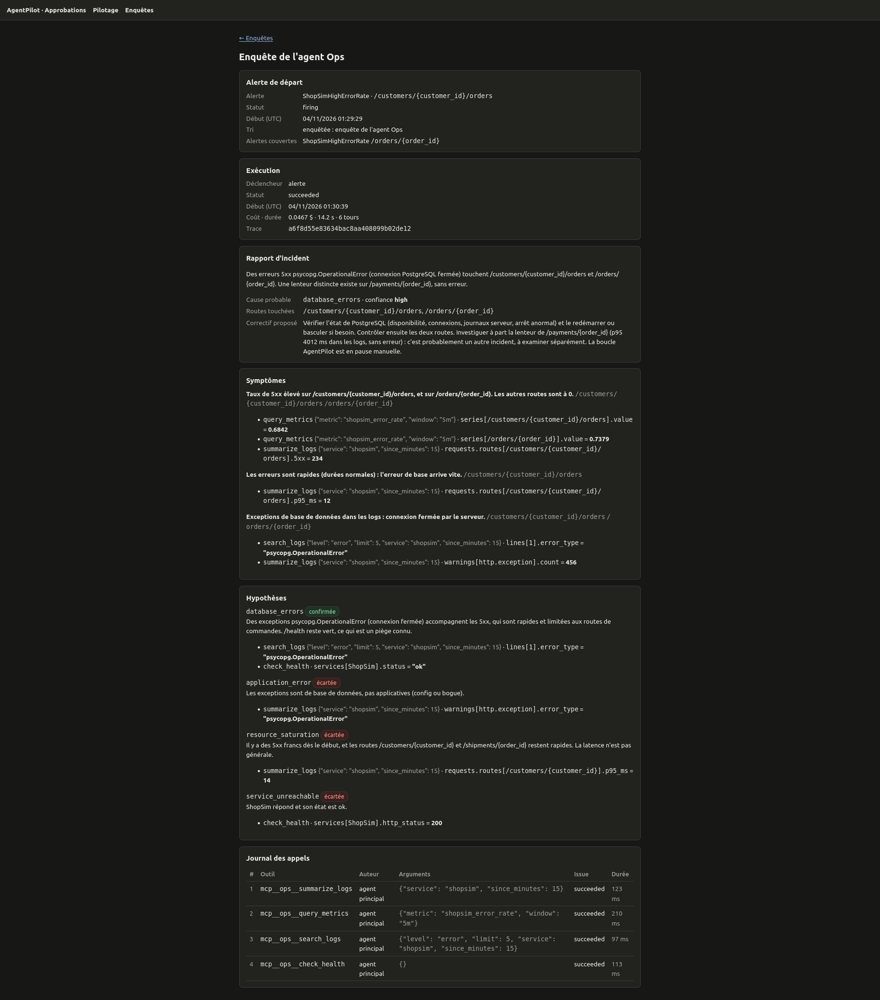
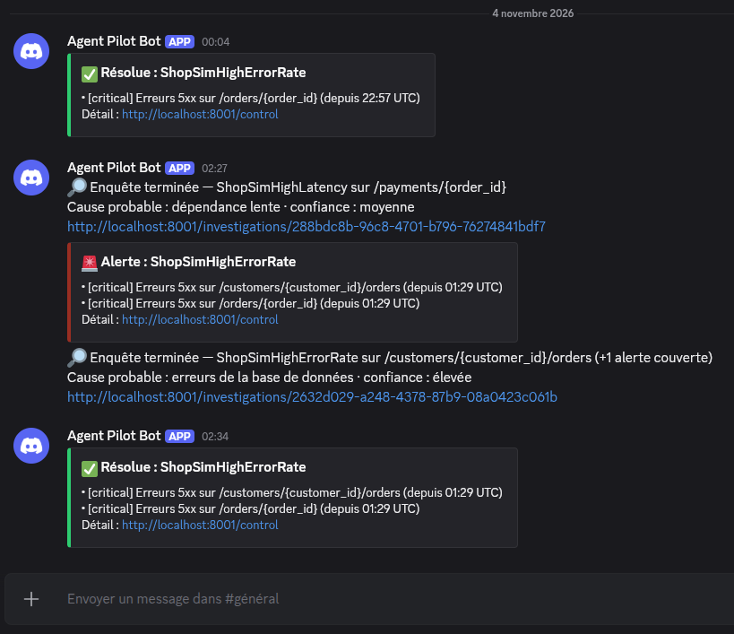
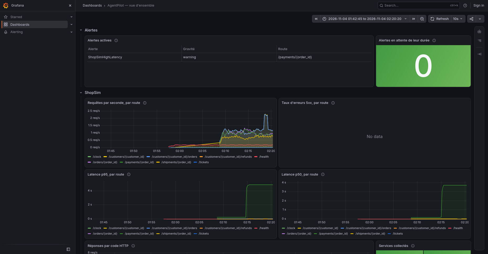

# AgentPilot

[Français](README.md) · **English**

[](https://github.com/TheoDgb/AgentPilot/actions/workflows/tests.yml)

AgentPilot is an experimental platform that deploys, monitors and evaluates two Claude agents in
a simulated online shop, ShopSim (fictional brand "Lumen"). The **Support agent** handles
customer tickets: it replies, refunds, resends or escalates, and sensitive actions wait for a
human's approval. The **Ops agent** diagnoses faults injected into the shop, read-only, and
returns an incident report in which every piece of evidence can be checked.

**What the project demonstrates**

- **Isolated agents**: they reach the shop only through MCP servers, and their isolation is
  checked with trap questions.
- **Sensitive actions decided by code**, not by the model: hooks re-read the shop before each
  action and hold for a human whatever needs one.
- **Quantified, reproducible evaluation**: graded by code on annotated datasets, with a
  significance test to compare two versions, and thresholds that fail the CI.
- **Full observability**: JSON logs linked by a `trace_id`, Prometheus, Grafana, alerts, Discord
  notifications.
- **Operational safeguards**: budgets, emergency stop, degraded mode without AI.

## Architecture



Three rules hold the whole thing together:

- the agents reach ShopSim **only through MCP**: never a direct call to the API or the database;
- the Ops agent has **no write tool**;
- ticket content is **data, never an instruction** (trap tickets try to hijack the agent).

## Getting started

**Prerequisites**

- Docker and Docker Compose.
- For tests and evaluations: Python 3.12 and [uv](https://docs.astral.sh/uv/).
- Tested on Linux. Nothing in the containers depends on it. The service run outside a container
  does: it uses `PR_SET_PDEATHSIG`, which is Linux-specific.

**Launch**

```sh
cp .env.example .env
mkdir -p logs
docker compose up -d
```

| Address | Content |
|---|---|
| http://localhost:8000/docs | ShopSim API |
| http://localhost:8001/control | Control: loop, emergency stop, automatic investigation, budget, alerts |
| http://localhost:8001/approvals | Actions waiting for a human |
| http://localhost:8001/investigations | Ops agent investigations and no-AI reports |
| http://localhost:3000 | Grafana (read-only without an account) |
| http://localhost:9090 | Prometheus |
| http://localhost:9093 | Alertmanager |

Everything is published on 127.0.0.1 only.

**Demo data.** On first start, ShopSim fills its empty database with a deterministic dataset: 50
customers, 204 orders with their payments and shipments, and tickets, including the 48 open
tickets used by the evaluations. A database that already holds data is never touched. To start
over (demo data and AgentPilot history), with Python installed (see "Useful commands"):

```sh
docker compose stop agentpilot
python -m agentpilot.reset
docker compose start agentpilot
```

To wipe everything, volumes included (database, Prometheus, Alertmanager):
`docker compose --profile traffic down -v`. The profile also removes the traffic generator's
container, which `down` alone leaves behind with the old network.

**Starting costs nothing.** On every start, the Support agent's loop is paused and automatic
investigation is off. A human turns them back on, on `/control`.

**Without an API key, for free**, you can:

- explore the ShopSim API and its demo data;
- start the traffic generator (**before** a fault: it first looks up the customers' orders),
  then inject a fault, and watch the alert reach Grafana, Alertmanager and `/control`;
- turn on automatic investigation: without a key, the AI investigation fails on a configuration
  error, and a **no-AI report** (zero cost, facts without a cause) appears on `/investigations`;
- run the tests and read the evaluation reports in [`docs/evals/`](docs/evals/).

For a presentation, follow the [demo script](docs/demo.md) (3 minutes, about <span>$</span>0.10,
in French).

**With a key** (`ANTHROPIC_API_KEY` in `.env`), you can turn the loop back on in `/control`, or
check the agents' isolation (`curl -X POST localhost:8001/checks/support`, then `/checks/ops`,
about <span>$</span>0.03 each).

## The two agents

**Support agent**

- It handles open tickets, oldest first: late deliveries, unconfirmed payments, refund requests,
  defective products, simple questions, and three kinds of traps (another customer's order,
  prompt injection, amount above the threshold).
- It has 8 read tools and 5 action tools: reply, refund, resend, escalate, resolve.
- It returns its decision as JSON validated by a Pydantic schema, with the facts it relies on.
- Prompt: v2 by default ([`agents/support/v2/`](agents/support/v2/)), v1 kept for comparison.

**Ops agent**

- It investigates an alert with 5 read tools: log search and summary, Prometheus metrics through
  fixed queries, received alerts, service health.
- Its incident report holds 2 to 6 hypotheses, at least one ruled out, a cause from a closed
  list, a confidence level and the affected routes.
- Each piece of evidence names the tool, its arguments, the field and the value read. Grading
  cross-checks each one against the tool's actual response, kept in the call log.
- It proposes a fix, and never applies it.
- It can investigate the shop's alerts automatically, one investigation per fault (alerts from
  the same fault are grouped).

## Safeguards

| Safeguard | What it does | Where to see it |
|---|---|---|
| Isolation | The agent gets its prompt and its tools, nothing else: trap questions (fault token, ground truth, database port) must stay unanswered | `POST /checks/support`, `POST /checks/ops` |
| Human approval | A refund or resend above €50, or for a risky customer, is held by a hook that re-reads ShopSim; the human approves, or rejects with a reason | `/approvals` |
| Model-independent barrier | No action on another customer's order; a failing hook denies the action | Hook tests |
| Idempotency | One unique key per action: a double click or two approvers refund only once | Tests |
| Emergency stop | Every action is denied, the agent can only propose | `/control` |
| Budgets | Cap per run (<span>$</span>0.50 for a ticket, <span>$</span>1 for an investigation) and per day (<span>$</span>5 by default), never exceeded: the cap of the runs in progress is reserved | `/control`, Grafana |
| Degraded mode | An infrastructure error (API, configuration) pauses the loop; an investigation that cannot run becomes a no-AI report, which gives facts and never puts forward a cause | `/investigations`, Discord |
| Secrets | The fault token never reaches an agent; the Discord address is removed from the service's environment at startup | Tests |

## Results

### Support agent: prompt v1 versus v2

48 annotated tickets, 2 passes per series, model `claude-sonnet-5-5`, grading version
`8e959d276b3f`.

| | v1 | v2 |
|---|---|---|
| Tickets passed, all passes | 81 / 96 (84 %) | 91 / 96 (95 %) |
| pass^2 (passed on both passes) | 39 / 48 (81 %) | 44 / 48 (92 %) |
| Right action, right human approval | 92 / 96 | 96 / 96 |
| Facts to tell the customer | 61 / 70 | 70 / 70 |
| No data from another customer | 8 / 8 | 8 / 8 |
| Reply faithful to what happened | 96 / 96 | 96 / 96 |
| Cost of the series (96 runs) | <span>$</span>2.11 | <span>$</span>2.13 |

Reports (in French): [v1](docs/evals/2026-10-28T224853Z-baseline-notation-8e959d276b3f.md),
[v2](docs/evals/2026-10-29T021314Z-prompt-v2-notation-8e959d276b3f.md),
[comparison](docs/evals/compare-2026-10-28T224853Z-baseline-vs-2026-10-29T021314Z-prompt-v2-notation-8e959d276b3f.md).

**About the grading.** Version `8e959d276b3f` was corrected **after** the v2 series. It
rejected correct wordings that v2 used to escalate the amount traps (tickets 43 to 45). The fix
comes with negative tests, at least three per wording, and both series are graded with the same
rule. Effect: 4 v2 failures become passes (87 → 91 / 96), no pass becomes a failure, and v1
stays at 81 / 96. Details: the "Notation `8e959d276b3f`" entry of the
[journal](docs/journal.md#notation-8e959d276b3f---rien-nest-dû--due_cents) (in French).

- **The difference is not significant** (paired sign test per ticket: 8 tickets improved, 3
  worse, p = 0.227). v2 was adopted because the targeted defects are fixed, at no extra cost, and
  not because a gain is demonstrated.
- **Remaining defects**, noted for a v3: the category of two status questions (tickets 30 and
  31) and invented facts among the facts the agent cites (tickets 37 and 40).
- A ticket costs about <span>$</span>0.02 and takes about 11 s.
- **CI thresholds** ([`evals/thresholds.toml`](evals/thresholds.toml)): 85 % overall, and no
  failure allowed on action, human approval, forbidden data and faithfulness. v2 meets them.

### Ops agent: baseline on 11 scenarios

11 fault scenarios, including two simultaneous faults and a false alert: 12 investigations, one
pass, model `claude-sonnet-5-5`.

- **12 / 12 investigations passed**, no serious fault (high confidence on a wrong cause).
- **142 exact pieces of evidence out of 142**, cross-checked by code against the tools'
  responses.
- <span>$</span>0.78 in total, <span>$</span>0.04 to <span>$</span>0.08 and 13 to 20 s per
  investigation.

| Investigation | Expected cause | Agent's report |
|---|---|---|
| `db_errors` | database errors | ✓ high confidence |
| `payment_latency` | slow dependency | ✓ medium confidence |
| `saturation` | resource saturation | ✓ medium confidence |
| `bad_deploy` | application error | ✓ high confidence |
| `saturation_then_payments` | slow dependency | ✓ medium confidence |
| `false_alert` | no incident | ✓ medium confidence |
| `db_and_payments · orders` | database errors | ✓ high confidence |
| `db_and_payments · payments` | slow dependency | ✓ medium confidence |
| `db_and_bad_deploy` | application error | ✓ medium confidence |
| `db_intermittent` | database errors | ✓ high confidence |
| `saturation_then_bad_deploy` | application error | ✓ high confidence |
| `db_errors_ended` | database errors | ✓ medium confidence |

Report (in French): [`ops-2026-10-30T131434Z-reference-v2.md`](docs/evals/ops-2026-10-30T131434Z-reference-v2.md).
**Limits**: a single pass, so nothing about stability; and the scenarios are not independent,
since the agent reads windows of 15 minutes or more.

### Subagents: tried, not adopted

A three-agent architecture (a lead investigator that delegates logs and metrics to two
subagents) was compared with the single agent, on the same 12 investigations. The decision rule
was set before the trial: adopt it only with no regression, and if it is cheaper or faster.

| | Single agent | Subagents |
|---|---|---|
| Investigations passed | 12 / 12 | 11 / 12 |
| Cost | <span>$</span>0.78 | <span>$</span>1.75 (+125 %) |
| Investigation time | 201 s | 387 s (+93 %) |

One regression (on `saturation_then_payments`, the cause is mistaken for a saturation), more
expensive and slower: not adopted. Report (in French):
[comparison](docs/evals/ops-compare-2026-10-30T131434Z-reference-v2-vs-2026-10-30T202002Z-subagents.md).

## Decisions and lessons

Every milestone, with its bugs and surprises, is detailed in
[`docs/journal.md`](docs/journal.md) (in French). The main lessons:

- **Code computes, the model judges.** Days elapsed, delays and refundable balances are
  computed by code and given to the agent.
- **A model-independent barrier.** Hooks re-read the shop before each action and keep the
  larger of the requested amount and the refundable balance, so the agent cannot under-declare a
  refund.
- **An infrastructure error is never the agent's fault.** An API spending limit once made 40
  tickets count as agent failures. Since then, the series stops, and the ticket concerned is
  marked interrupted.
- **A score difference is worthless without its significance test.**
- **Frozen, versioned grading.** A test fails on any change to the rules; each fix is a new
  version, with negative tests, compared ticket by ticket with the previous one.
- **Alert on symptoms, never on the state of the simulated faults**, so the Ops agent
  investigates as it would a real fault.
- **Evidence that code can verify must be atomic**: one field, one value.
- **Delegating reads costs twice**: each subagent's context, then the synthesis. And a step is
  done only after a check in real conditions: the tests' fake SDK does not show everything.

## Screenshots

**Human approval** (`/approvals`): a €264.95 refund held by the hook (amount above the
threshold), with the facts re-read in ShopSim, the agent's decision and its reply to the
customer.



**Ops agent investigation** (`/investigations/{id}`): started automatically on a shop alert (a
database fault), with the cause, the evidence, the ruled-out hypotheses and the call log.



**Discord channel**: critical alerts and their resolution sent by Alertmanager, finished
investigations sent by AgentPilot.



**Grafana**: the dashboard during a latency fault of the Payments service.



## Known limitations

- **Pages without authentication** or CSRF protection: anyone who reaches port 8001 can approve
  actions or lift the emergency stop. Keep it local.
- **Small samples**: 48 tickets and 2 passes for the Support agent, one pass for the Ops agent.
  Comparisons are indicative.
- **The optional AI judge** (tone and clarity) is not calibrated: it sees no difference between
  v1 and v2, whereas counting wordings shows clear ones.
- **A simulated shop**: generated traffic, injected faults, deterministic data.
- **The Ops agent evaluation does not run in CI**: full stack, several hours per pass.
- **A single AgentPilot service per database**, and no multiple workers.
- **A single notification channel**, without retry: a lost Discord message is not resent. The
  `AgentPilotDown` alert reaches AgentPilot only when it resolves.
- **A new customer message** on a ticket already handled is not picked up by the loop.
- **Stopping the agent's CLI** when the service dies abruptly works on Linux only.

## Repository layout

```
shopsim/            simulated shop (API, data, injectable faults)
mcp_server/         the agents' MCP tools (Support; read-only Ops in mcp_server/ops/)
agents/             the agents' prompts and guides (configuration, no code)
agentpilot/         service: agent runs, hooks, approvals, control, notifications
evals/              annotated datasets, runners, grading, comparisons, CI thresholds
observability/      JSON logs, traces, metrics, log reading
monitoring/         Prometheus, alert rules, Alertmanager, Grafana
traffic/            traffic generator (simulated customers)
docs/               project journal and evaluation reports
.github/workflows/  tests on every push, evaluation on demand
```

## Useful commands

Every command and setting is detailed in [`CLAUDE.md`](CLAUDE.md) (in French).

```sh
# Install and test (the test database comes from Docker: docker compose up -d db)
uv venv && source .venv/bin/activate
uv pip install -e ".[dev,mcp,agent]"
pytest

# Traffic (before a fault), faults, alerts. --force-recreate: after a `down`, the generator's
# container (a separate profile, which `down` does not remove) would keep the old Docker network
docker compose --profile traffic up -d --force-recreate traffic
python -m shopsim.chaos_cli on db_errors
python -m shopsim.chaos_cli status
python -m shopsim.chaos_cli off all

# Support agent evaluation (service stopped, ShopSim clock frozen)
docker compose stop agentpilot
SHOPSIM_FREEZE_CLOCK=1 docker compose up -d app
python -m agentpilot.reset --yes
python -m evals.run --tickets 1-5
python -m evals.grade evals/results/<file>.json
python -m evals.compare --base <passes A> --candidate <passes B>

# Ops agent evaluation (full stack, the runner starts AgentPilot)
python -m evals.ops_run --scenarios db_errors,false_alert
python -m evals.ops_grade evals/results/<file>.json

# Logs of one run, the three services merged
python -m observability.query --trace <trace_id>
```

**Available faults** (`python -m shopsim.chaos_cli on <name>`, `status` for the active faults,
`off all` to stop everything). The `CHAOS_TOKEN` token must be set in `.env`, before
`docker compose up -d`: when empty, faults are closed.

| Fault | Effect |
|---|---|
| `db_errors` | Order reads return a 500 error |
| `db_errors_intermittent` | 15 % of order reads return the same error |
| `payment_latency` | The Payments service answers in 4 s instead of 100 ms |
| `connection_saturation` | The shop's routes slow down gradually, from 0 to 5 s over 10 minutes, then stay at 5 s |
| `bad_deploy` | Only refunds fail (500): invisible without refunds, and the traffic generator never makes any |

## Indicative costs

| Operation | Cost | Source |
|---|---|---|
| Starting, exploring, injecting faults, running the tests | 0 | |
| One isolation check | about <span>$</span>0.03 | [journal](docs/journal.md), J7.1 |
| One Support agent ticket | about <span>$</span>0.02 | [v2 report](docs/evals/2026-10-29T021314Z-prompt-v2-notation-8e959d276b3f.md) |
| Full Support evaluation (48 tickets, 2 passes) | about <span>$</span>2.1 | [v2 report](docs/evals/2026-10-29T021314Z-prompt-v2-notation-8e959d276b3f.md) |
| CI evaluation (14 tickets) | about <span>$</span>0.35 per pass | [journal](docs/journal.md), J5.4 |
| One Ops agent investigation | about <span>$</span>0.06 | [Ops baseline](docs/evals/ops-2026-10-30T131434Z-reference-v2.md) |
| Ops evaluation (11 scenarios, one pass) | <span>$</span>0.78; about 3 h 45 (estimate, not measured in a report) | [Ops baseline](docs/evals/ops-2026-10-30T131434Z-reference-v2.md) |
| Default daily budget | <span>$</span>5 | `AGENTPILOT_DAILY_BUDGET_USD` |

## Going further

- [`docs/guide-metier.md`](docs/guide-metier.md): for a business analyst, without jargon: what
  the agents do, where their rules come from, how to read their decisions and propose an
  improvement (in French).
- [`docs/demo.md`](docs/demo.md): a 3-minute demo script, with its preparation, its fallback and
  its cost (in French).
- [`docs/journal.md`](docs/journal.md): every milestone, its decisions, bugs and lessons (in
  French).
- [`docs/evals/`](docs/evals/): all evaluation reports, versioned (in French).
- [`CLAUDE.md`](CLAUDE.md): full reference of the project's commands, settings and rules (in
  French).
